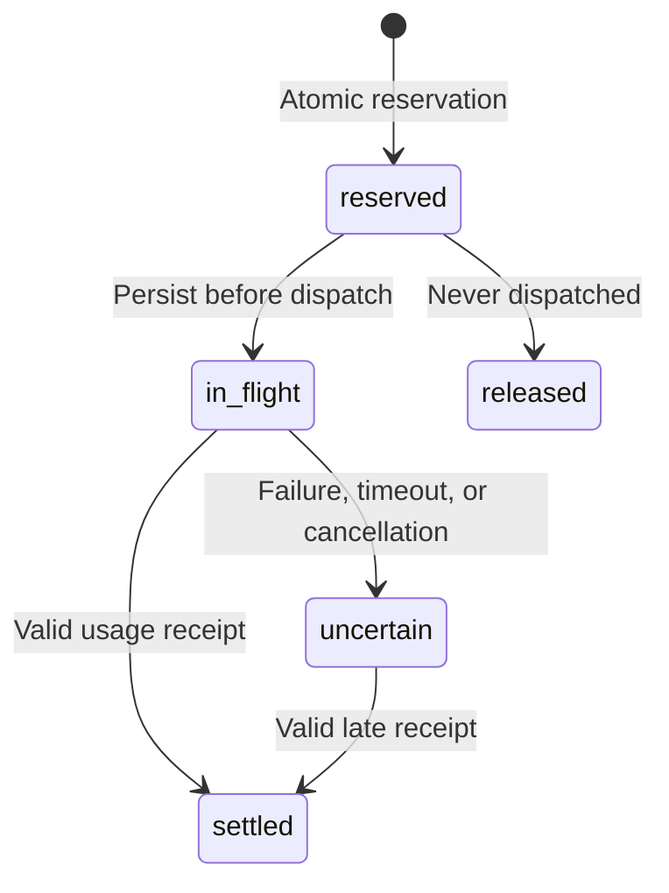

# Durable inference budget ledger

Status: local SQLite implementation, integrated with configured terminal actor runs. Verification uses software fixtures and fake provider transport. No live provider billing has been verified.

## Scope

The ledger reserves reported tokens and estimated inference cost before adapter dispatch. It uses `.redteam/budgets.sqlite`, owner-only permissions, write transactions, and immutable invocation identities. Separate processes share the same reservations.

Each run defines a cap, deadline, verification reserve, and report reserve. Investigation receives the remainder. Pools cannot borrow from each other. A closing run rejects new investigation while allowing reserved verification and report capacity. A closed or expired run rejects new dispatch.

Configured actor runs currently have one actor and no model-based verifier or reporter. They allocate their whole selected cap to investigation. The ledger supports protected pools for future coordinated runs; this does not enable specialist agents or pass the broader hierarchy gate.

## Invocation states



Reserved, in-flight, and uncertain calls retain their full maximum liability. Settlement replaces that maximum with actual reported usage. Only a reservation that never dispatched can be released without a receipt. Restart and cancellation do not make an uncertain call free.

The same invocation identity cannot change its run, task, pool, maximum, or pricing reference. It cannot dispatch twice. An identical receipt can settle idempotently; a changed settled receipt is rejected.

An overrun receipt is retained in full, including spend beyond the reservation. It closes the run and prevents new dispatch. It cannot reverse a charge already made by a provider. Other unknown liabilities remain held.

## Reports and terminal inspection

Configured runs save four artifacts: frozen manifest, worker result, budget snapshot, and task snapshot. They also include the report-time budget state in JSON and Markdown. Recovered interrupted runs can have three artifacts when no sealed worker result survived.

```sh
redteam budgets show RUN_ID
```

This command reads current invocations, held amounts, reported spend, allocations, and transition events. Aggregated spend and held values are decimal strings so even overrun totals preserve integer precision. Individual quantities use safe integers.

A late adapter receipt can settle after the actor stops. It updates the durable ledger without reopening the run or rewriting an earlier report. Inspect the current ledger when a saved report contains unsettled liability. Reports remain snapshots of what was known when they were created.

## Boundaries

- Cost uses the operator's configured rates. It is not a provider-enforced billing cap or reconciled invoice.
- Provider receipts and adapters remain trusted. Fabricated usage cannot be independently detected here.
- The current adapter wrapper reserves its entire remaining request allowance. It is conservative and may serialize concurrent callers. A future scheduler must reserve bounded individual requests under the same parent cap.
- Local configured actor leases and cancellation are integrated. Browser time, tool fees, infrastructure cost, a retry scheduler, and distributed workers are not integrated with this ledger.
- Database lock waits can extend local response latency. Dispatch checks the deadline again before calling the adapter. Production worker isolation and stronger timing controls remain open.
- Records contain run/task/configuration references and quantities. They exclude API keys, prompts, research text, and provider error bodies.
- Unknown usage cannot be cleared through the CLI. Billing reconciliation needs authenticated receipt provenance before such an operation is added.
