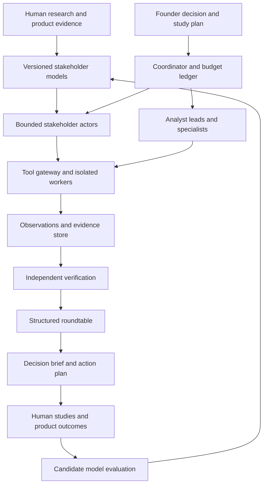

# Redteam: Master Plan

Version: 1.4

Date: October 26, 2026

Status: Planning baseline for development

Project name: redteam

Writing basis: ASD-STE100 Simplified Technical English, Issue 9

STE status: Principles applied. Full rule and dictionary verification remains open.

This plan defines the product, research program, system architecture, and development sequence. It also defines the evidence required for release.

All market choices, operating limits, schedules, and commercial targets below are proposals. They require pilot evidence before adoption.

**Product promise:** Give the system an idea or an app, target stakeholders, and a decision. Receive evidence-linked findings, clearly labeled objections, and prioritized actions. Verified app problems require actual scoped tests; supplied idea claims remain unverified until evidence supports them.

## 1. Product purpose

The system helps startup teams make specific decisions about ideas and apps with better evidence. It combines structured idea analysis, scoped app tests, stakeholder research, controlled simulations, and independent review. The active subject scope is ideas and apps only. CVs, general services, and universal subject review are outside current development. See the [scope and intake plan](idea-and-app-scope.md).

The long-term product can support launch, product changes, pricing, market entry, operations, and investor preparation. Each review must address a defined decision.

A dated global-context layer is required for relevant news, technology, competitors, market conditions and policy. Each review must show its as-of time, inspected sources, regional/language coverage, freshness and unresolved conflicts. News does not establish country psychology or purchase/investment intent. The implementation sequence and release gates are in the [global context plan](global-context-plan.md). Explicit population collection and an internal primary software-release helper now exist. Active news feeds and context-aware review integration remain planned; current global awareness is not established.

The first decision is: **What must this team fix or learn before a paid pilot?**

The system produces six useful results:

- Verified app problems with reproduction evidence.
- Stakeholder reactions with clear model limits.
- Simulated purchase and investment decisions with reasons and conditions.
- Business objections with supporting sources or explicit assumptions.
- A ranked list of fixes and experiments.
- A record of changes and later outcomes.

The central quality measure is decision usefulness. Agent count, report length, and persuasive language are secondary measures.

## 2. Initial scope and assumptions

The recommended first customer is a small team with a self-service B2B software idea or app. The team is preparing to test its assumptions or run a paid pilot. An idea can enter without an app, URL, repository, or test account. App execution remains a separate granted and bounded operation.

This customer choice is a planning assumption. Founder discovery can change it before implementation.

| Item | Initial planning default | Reason |
|---|---|---|
| Product access | One staging web app and test accounts | Supports controlled interaction and repeat tests |
| Market | One selected country and language | Makes recruitment and local review practical |
| Customer roles | Daily user, buyer, and administrator | Exposes different goals and decision authority |
| Journeys | Three critical journeys | Creates a bounded review |
| Research models | Two or three narrow stakeholder models | Supports deeper study of relevant behavior |
| Analyst teams | Engineering, product/research, commercial, verification | Covers the initial decision |
| Investor review | Defined investor profiles and investment decision scenarios | Supports fundraising preparation within available evidence |
| Output | Decision brief, evidence, actions, and experiments | Connects investigation to work |

The first app and market remain unselected. Selection must depend on accessible design partners and recruitable stakeholders.

A consumer app pilot can use the same architecture. Its roles can include first-time users, returning users, payers, and household decision-makers.

The first release excludes population adoption forecasts, automated funding predictions, and unrestricted production actions. Native mobile execution follows after web testing works reliably.

Security review initially covers explicitly scoped checks. A broad penetration test requires a separate engagement and operating policy.

## 3. Subject modes and evidence levels

The product has two subject modes: idea and app. Idea review inspects supplied assumptions, alternatives, business logic, evidence gaps, and proposed tests. App review can inspect actual product behavior within granted execution scope. Both use the same evidence labels, research boundaries, and reporting system. Structured intake and scope preview precede idea review execution.

The product also has separate evidence levels. These are not substitutes for the subject type. Each level has its own release gate.

| Mode | Function | Permitted conclusion |
|---|---|---|
| Idea analysis | Inspects supplied context and explicit assumptions | This objection or next test follows from the stated inputs; demand and feasibility remain unverified |
| App review | Tests actual product behavior | The tested journey produced this result |
| Grounded scenario | Uses researched stakeholder models | This model reacted this way under these conditions |
| Validated prediction | Predicts a previously evaluated behavior | This prediction has measured validity within the stated scope |

Idea analysis and app review can operate before behavioral prediction passes validation. A grounded scenario must show its research sources and untested assumptions. An analytical customer or investor lens must be labeled as such; it is not a researched person's reaction.

A validated prediction must identify its task, population, environment, evaluation results, and model version.

The system must never convert a simulated purchase into evidence of actual demand. It must keep actual observations and generated behavior separate.

Each mode has an independent release path:

- Idea analysis requires traceable inputs, explicit unknowns, checked reasoning boundaries, and demonstrated usefulness; saving a brief alone does not pass this gate.
- App review requires verified findings, operational integrity, and demonstrated customer value.
- Grounded scenarios additionally require research provenance and controlled actor boundaries.
- Validated prediction additionally requires successful held-out evaluation within the claimed scope.

A failed prediction gate does not prevent a useful app-review pilot. Model features remain conditional on the selected mode.

## 4. Stakeholder map

Stakeholders have different information, incentives, authority, and consequences. The research must describe these differences before agent configuration.

| Stakeholder | Decisions to study | Relevant evidence |
|---|---|---|
| End user | Start, understand, complete, return, leave | Observed tasks, interviews, usage, support |
| Buyer or payer | Compare, approve, pay, renew | Purchase histories, objections, choice tasks |
| Administrator | Configure, control access, maintain | Setup tasks, incidents, operating procedures |
| Engineer | Accept technical risk, estimate work | Code, tests, architecture, incidents |
| Support operator | Resolve issues, escalate, manage effort | Support cases, workflows, service data |
| Investor | Continue diligence, reject, request evidence | Mandates, interviews, decision criteria, available business data |
| Partner | Integrate, distribute, continue a relationship | Partner interviews, contracts, delivery constraints |

One person can occupy several roles. The model must preserve the role and context of each decision.

The investor model requires a defined stage, sector, mandate, and evidence standard. It must not claim to represent a named investor.

## 5. Behavioral research program

### 5.1 Research unit

The basic research unit is a decision in a defined situation. Broad claims about a person's entire psychology are outside the initial scope.

Examples include understanding an offer, choosing a plan, asking for reassurance, completing setup, and deciding whether to continue diligence.

Each study defines an observable outcome before data collection. Examples include correct comprehension, completion, abandonment location, chosen alternative, and questions asked.

### 5.2 Research methods

| Method | Purpose | Required record |
|---|---|---|
| Past-decision interview | Discover motivations, constraints, and actual experiences | Transcript, context, date, permitted use |
| Observed app task | See actions, errors, recovery, and comprehension | Task, environment, action sequence, outcome |
| Choice exercise | Examine tradeoffs across realistic options | Alternatives, presentation, choice, stated reason |
| Operational evidence | Compare reported experience with actual behavior | Relevant events, definitions, collection limits |
| Local review | Check language and market assumptions | Reviewer, changes, unresolved concerns |

The research must preserve contradictions between statements and actions. It must also record cases that challenge the proposed segment model.

Human and agent scenarios need comparable framing, alternatives, assistance, and decision opportunities. A forced completion task cannot validate voluntary abandonment.

The protocol must record incentives, task order, coaching, and think-aloud conditions. Comparisons require randomization or counterbalancing when order could affect results.

Tool or perception failures need separate labels from stakeholder decisions. Actor execution time cannot stand in for human effort.

Recruitment should cover relevant variation in experience, need, budget, authority, language, device, connectivity, and alternatives.

An exploratory allowance is 8–12 participants per narrow segment. This allowance supports scheduling. It does not establish statistical sufficiency.

The research lead must set validation sample sizes through a precision or power analysis. Repeated tasks from one participant require appropriate clustered analysis.

### 5.3 Research deliverables

- A stakeholder map and decision map.
- An interview and observation protocol.
- A recruitment plan with inclusion criteria.
- Annotated decision events and contradictory cases.
- A source register with permitted uses.
- Candidate segment models and missing evidence.
- A locked validation protocol.

The default model represents a de-identified composite segment. A replica of a named person is unnecessary for the initial product.

### 5.4 Research basis

A study of 1,052 Americans found better held-out survey performance from interview or survey grounding than from demographic descriptions alone. Its measures concerned specific survey and experimental tasks. App interaction requires separate validation. [Research paper](https://arxiv.org/abs/2411.10109)

This plan therefore treats richer grounding as a design hypothesis. It requires direct tests of each intended product use.

## 6. Stakeholder model specification

Every model field must link to evidence or carry an assumption label. Each model has a version and a permitted scope.

| Field | Required content |
|---|---|
| Identity and scope | Role, product category, segment, market, language, version |
| Goals | Desired results and competing priorities |
| Incentives | Personal, financial, organizational, and social consequences |
| Constraints | Budget, authority, time, device, access, switching effort |
| Knowledge boundary | Known facts and discoverable information |
| Beliefs | Expectations about the problem, app, alternatives, and risk |
| Experience | Relevant successes, failures, and category familiarity |
| Decision process | Comparisons, consultation, thresholds, and stopping rules |
| Dynamic state | Task progress, urgency, attention, resources, unresolved concerns |
| Memory rules | Events retained and conditions for updates |
| Action policy | Available actions and the process that selects them |
| Variation | Supported attribute combinations, dependencies, and differences within the segment |
| Uncertainty | Sparse evidence, contradictions, and abstention conditions |
| Validity card | Evaluation scope, prediction horizon, interaction history, results, weaknesses, and review date |

Psychological constructs require operational definitions. The system must not invent precise trust or risk scores without a measurement basis.

For example, a trust measure could use a defined participant question and observed follow-up behavior. Its predictive contribution must then pass evaluation.

Broad personality measures are optional research inputs. Their inclusion must improve relevant predictions or support a justified research question.

Instance generation must preserve researched attribute relationships and feasibility constraints. It must not combine independently sampled attributes into unsupported profiles.

The generator has its own version and checks. Unsupported combinations require an exploratory scenario label and cannot support population conclusions.

### 6.1 Actor decision cycle

An actor follows this cycle:

1. Observe the permitted interface and information.
2. Update task state and supported beliefs.
3. Identify feasible actions.
4. Select an action under its decision policy.
5. Execute the action through the tool gateway.
6. Record the result and concise explanation.
7. Continue until a stopping condition applies.

The action set includes comparison, help-seeking, delay, rejection, and abandonment. Completion must not be the actor's only valid outcome.

Actor time and attention limits require research support. A language model's execution speed cannot establish human task time.

### 6.2 Illustrative model

This example is a design illustration. It does not describe a validated population.

The actor needs a result urgently and has a fixed spending limit. Previous unexpected charges make total pricing relevant to its decision.

The actor sees the public offer and visible help content. It cannot see internal product notes or the engineering team's explanation.

The scenario records whether the actor finds total pricing, compares an alternative, requests help, or stops. Human observations will test these predictions.

### 6.3 Consumer purchase decisions

Consumer actors must model buying mentality through observable decisions. They must consider the offer, alternatives, price, and purchase experience.

The model must distinguish desire, willingness to pay, ability to pay, and purchase authority. These factors can produce different outcomes.

| Decision factor | Required model content |
|---|---|
| Need and urgency | Problem importance, timing, and expected benefit |
| Value and price | Supported price sensitivity and perceived value |
| Affordability | Available funds, permitted credit, and spending constraints |
| Trust and risk | Evidence requirements, prior experiences, and perceived uncertainty |
| Alternatives | Competing products, existing habits, and doing nothing |
| Switching effort | Setup, learning, migration, and relevant commitments |
| Authority | Individual, household, or organizational approval |
| Payment access | Available methods and transaction requirements |
| Situation | Market context, device, language, and current task state |

The action set includes buy, subscribe, try, compare, seek approval, defer, abandon, and reject. Renewal and cancellation require longitudinal validation.

An attractive offer can receive a rejection because of affordability or a better alternative. Interest alone must not imply a purchase.

The actor cannot complete a simulated purchase without modeled funds, payment access, and required approval. These constraints must match the scenario.

The report must state **buy, decline, defer, buy if conditions change, or insufficient information**. It must preserve the preceding actions.

Each decision includes reasons, evidence, barriers, and unmet conditions. Suggested changes remain hypotheses until independent evidence supports their effect.

Price scenarios can compare defined offers under controlled conditions. Maximum acceptable prices require supporting choice evidence or an explicit unknown value.

Purchase execution uses test transactions under the study policy. A simulated purchase is not customer revenue.

### 6.4 Investor investment decisions

Investor actors must decide whether they would invest under a defined mandate. Their decisions must reflect available information and decision authority.

| Decision factor | Required model content |
|---|---|
| Mandate | Stage, sector, geography, and permitted business models |
| Capital | Available allocation, investment size, and portfolio limits |
| Terms | Supplied valuation, ownership requirements, and relevant conditions |
| Return requirements | Supported investment horizon and decision criteria |
| Business evidence | Team, traction, economics, differentiation, and market assumptions |
| Diligence | Required checks, unresolved risks, and missing documents |
| Authority | Individual decision, partner recommendation, or investment committee approval |
| Alternatives | Other opportunities and capital constraints, when supplied |

A strong product can receive a pass because it falls outside the mandate. Product approval must not automatically produce investment approval.

The action set includes pass, monitor, request information, begin diligence, recommend investment, approve investment, and propose conditional investment.

The final verdict must state **invest, pass, conditional investment, defer for evidence, or insufficient information**. It must identify the decision stage.

A partner recommendation and committee approval require separate records. Required diligence and authority checks cannot be bypassed by a favorable assessment.

An invest verdict requires a proposed amount within available capital and supplied terms. Unknown material terms require a conditional verdict or deferral.

Each decision includes mandate fit, reasons, missing evidence, unresolved objections, and conditions that could change the verdict.

Investor subagents can examine market evidence, technical risks, economics, and terms. Their scope must match the actor's permitted diligence resources.

The simulation creates no actual investment commitment. Its verdict does not establish the probability of obtaining funding.

### 6.5 Shared decision record

Both modules must store the actor's action before its report explanation. The explanation remains a model account linked to available evidence.

Each decision record includes:

- Model version, scenario, actor state, and decision time.
- Available information and relevant evidence references.
- Action sequence, final verdict, and decision stage.
- Price or investment terms, where applicable.
- Reasons, constraints, missing evidence, and unmet conditions.
- A proposed validation method and supported prediction horizon.

Numeric likelihoods require evaluated probability calibration. Otherwise, the report provides a verdict with a qualitative evidence assessment.

The first purchase and investment modules can operate as grounded scenarios. Predictive labels require separate evaluation for each decision type.

## 7. Country and population modeling

The model structure has five layers:

1. Shared decision mechanisms relevant to the task.
2. Market conditions and available infrastructure.
3. Researched stakeholder segments.
4. Variation between individuals within each segment.
5. The current situation and task state.

Market conditions can include language, prices, payment access, connectivity, and institutional requirements. These conditions must not determine an individual's values automatically.

The target population is the startup's prospective customer base. It is not the country's total population.

Population weights require defensible customer or sampling data. If weights are unknown, the system reports separate segment scenarios and sensitivity ranges.

Repeated agent runs measure simulation variation. They do not create additional independent human participants.

A cross-country economic-preference study found weaker recovery of cultural patterns than some demographic patterns. Its findings support local evaluation before broad market claims. [Research paper](https://www.nature.com/articles/s41562-026-02611-4)

Each additional country requires a coverage assessment, local review, and relevant validation. Translation alone does not complete market adaptation.

Country labels must not fill missing psychological attributes. The system must preserve the uncertainty in those fields.

## 8. Two operating structures

The system separates specialist investigation from stakeholder encounters. This separation protects the realism of the encounter and the depth of the investigation.

### 8.1 Analyst hierarchy

The coordinator assigns work to lead analysts. Leads request specialists when a material question needs further investigation.

| Lead | Example specialists | Required output |
|---|---|---|
| Engineering | Functional testing, performance, accessibility, scoped security | Reproducible findings and technical limits |
| Product and research | Journey analysis, research synthesis, local review | Friction evidence and research questions |
| Commercial | Positioning, alternatives, economics, investor diligence | Supported objections and business assumptions |
| Verification | Reproduction, source checks, claim checks | Verification decisions and counterevidence |

Verification remains independent from the agent that proposed the finding. A deterministic test should verify an objective claim where possible.

### 8.2 Stakeholder actors

Actors use approved models and bounded scenarios. They receive only information that fits their defined situation.

An investor actor can request diligence assistance if its scenario permits that assistance. A customer actor receives realistic customer resources.

Specialists cannot silently expand an actor's knowledge. Any permitted consultation must appear as a scenario event.

### 8.3 Architecture diagram

## 9. Delegation policy

Every subagent assignment needs a specific question and a defined deliverable. The coordinator approves the assignment through system policy.

The request must contain:

- The decision that the answer could affect.
- A question that has no existing assignment.
- Required inputs and permitted capabilities.
- A result schema and evidence requirement.
- A reserved budget and deadline.
- Child limits and stopping conditions.

The initial operating envelope is a prototype default:

| Control | Proposed limit |
|---|---|
| Hierarchy | Coordinator, lead, specialist |
| Agent instances | 12 per run, excluding the coordinator |
| Active workers | 4 per run |
| Children | 3 per lead, within the run limit |
| Follow-up round | 1 after initial verification |
| Run deadline | 45 minutes after access checks |
| Spending | A selected hard cap enforced before dispatch |
| Verification reserve | 20% of the selected spending cap |
| Report reserve | 10% of the selected spending cap |
| Closure window | Final 5 minutes of the run deadline |

These limits require load and quality tests. They do not describe an optimal agent configuration.

The instance cap includes actors, leads, specialists, verifiers, and replacement agents. It applies across the complete run and follow-up work.

A retry keeps its task identity and consumes attempt limits. The coordinator has a named allocation within the same spending cap.

Budget reservations must be atomic. They must cover each request's maximum bounded cost, including work already in progress.

The ledger includes tokens, tool actions, browser time, external tool fees, and active tasks. Requests need known limits and current price references.

Each request needs bounded output, duration, and fees. Retry and cancellation allowances must remain within the same maximum liability.

The coordinator protects verification and report reserves. It stops new investigations before the closure window.

If model-based synthesis is unavailable, stored records produce a factual partial report. Unverified findings retain their status.

Cancellation must propagate to child tasks. At the limit, the system stops new investigations and reports incomplete coverage.

## 10. Review lifecycle

1. Select the business decision.
2. Define the app build, market, stakeholders, and journeys.
3. Check access and permitted actions.
4. Select models and display their validity limits.
5. Freeze the study manifest.
6. Run stakeholder encounters and analyst investigations independently.
7. Preserve initial outputs before cross-agent exposure.
8. Verify material claims.
9. Review contradictions in the roundtable.
10. Run approved follow-up investigations.
11. Produce the decision brief and evidence report.
12. Track actions, experiments, and later results.

The state machine must enforce permitted transitions and their guards.

| From | To | Required condition |
|---|---|---|
| Created | Queued | Manifest is frozen and policy checks pass |
| Queued | Preflight | Worker and budget allocation are available |
| Preflight | Running | Access and fixtures pass checks |
| Preflight | Needs access | Required access fails; the run terminates |
| Running | Verifying | Initial outputs are sealed |
| Verifying | Debating | Required initial verification finishes |
| Verifying | Synthesizing | No roundtable or follow-up is required |
| Debating | Follow-up | A permitted round and budget reservation remain |
| Follow-up | Follow-up verification | Follow-up outputs are sealed |
| Follow-up verification | Synthesizing | Follow-up findings retain verification results |
| Debating | Synthesizing | No approved follow-up remains |
| Any active state | Closing | Cancellation, deadline, failure, or spending stop occurs |
| Closing | Finished | Partial report records incomplete and unverified work |
| Synthesizing | Finished | Report integrity checks pass |

Terminal outcomes include complete, limited coverage, needs access, canceled, budget exhausted, and failed. Each outcome preserves completed observations.

A needs-access result requires a linked new run after access changes. It cannot silently resume under an outdated manifest.

Retries cannot modify sealed outputs or bypass phase guards. A partial report cannot mark unfinished verification as passed.

A tool failure must not become a product failure. A missing test must not become a passing test.

The roundtable exchanges structured claims, counterevidence, and questions. Agent agreement does not verify a claim.

Phase permissions enforce independent initial work. Analysts cannot read another team's initial findings until the relevant outputs are sealed.

Initial working observations use task-scoped namespaces. Actor restrictions continue after the roundtable receives analyst evidence.

Research on multi-agent debate documents agents reinforcing other agents' responses. This plan therefore requires independent initial work and external verification. [Research paper](https://aclanthology.org/2025.findings-acl.1141/)

## 11. Evidence, claims, and recommendations

Each material statement receives an explicit type.

| Type | Meaning | Example |
|---|---|---|
| Observation | A recorded app or human event | The submit action returned an error |
| Source-supported statement | A statement supported by a checked source | The supplied policy specifies this requirement |
| Simulated behavior | An action produced by an actor | This actor requested more pricing information |
| Hypothesis | An interpretation that requires a test | Hidden pricing may discourage this segment |
| Recommendation | A proposed action | Test a price preview before registration |

Verification status is separate from claim type. Status values include unreviewed, supported, reproduced, disputed, and insufficient evidence.

The evidence service must keep the original source, capture date, scope, hash, and collection method. Summaries must link to original evidence.

Every finding follows this chain:

**Evidence → affected stakeholder goal → business implication → proposed action → validation method.**

The implication can remain a hypothesis even when the app observation is verified.

A reproducible event becomes a defect only against an expected result. That expectation needs a requirement, supported standard, or agreed functional rule.

If the expectation is unknown, the report records the event and uncertainty. It can still propose usability research.

Priority depends on severity, affected journeys, evidence strength, decision relevance, and available effort estimates. Missing inputs must remain visible.

The system must not calculate a financial impact without a supported basis. It must not hide distinct risks inside one startup success score.

## 12. Founder experience and report

The interface starts with the founder's decision. It then collects the minimum information required for that review.

| Screen | Main content |
|---|---|
| Review setup | Decision, app access, build, journeys, stakeholders |
| Scope preview | Available models, exclusions, estimates, spending cap |
| Run status | Progress, evidence captured, access problems, remaining budget |
| Decision brief | Decision conditions, blockers, evidence gaps, next five actions |
| Finding detail | Reproduction, evidence, stakeholder scope, counterevidence |
| Model library | Sources, supported tasks, validity cards, versions |
| Action workspace | Owner, next step, validation method, status |
| Release comparison | Resolved issues, regressions, new evidence |

The report contains a concise first page and supporting detail. Each finding links to evidence that the founder can inspect.

The report must show tested coverage and inaccessible areas. It must preserve material disagreements.

The report covers engineering, customer experience, market assumptions, commercial questions, and future experiments where evidence permits.

The purchase appendix shows decisions by researched segment, with price, trust, affordability, and approval barriers.

The investor appendix shows decisions by investor profile, mandate fit, diligence stage, and conditions. It also lists objections and required proof.

Both appendices identify missing evidence and the next real-world validation experiment. Aggregate summaries require defensible segment weights.

A roadmap appendix ranks fixes and experiments with dependencies.

Future plans use explicit scenarios and supplied assumptions. A proposed scenario does not establish what will happen.

## 13. System components and proposed stack

The initial architecture is one application with separate worker processes. Components have clear interfaces without requiring separate network services.

Web and terminal access are core product requirements. Users can install Redteam through a terminal and open its dashboard from the same workspace. Both interfaces must use the same policy checks and records.

The first distribution is a local npm archive with a compiled CLI and bundled dashboard assets. The local service binds to the loopback interface. SQLite stores workspace state. The future hosted edition adds tenant authentication, managed secrets, isolated workers, and PostgreSQL. These hosted controls are separate release requirements.

The CLI supports workspace startup, review submission, run inspection, evidence verification, scoped access grants, authenticated session import, and revocation. A grant records a specific target, capabilities, and expiry. It must not imply unrestricted shell access or start unrequested actions. The dashboard must show the same grants and current job states.

Browser credentials remain in the tool layer. Local session imports are encrypted, excluded from normal output, and removed from active retrieval when revoked. Users must be able to inspect granted access from either interface. External execution requires its own runner and isolation gate after access management is implemented.

| Component | Responsibility | Proposed initial implementation |
|---|---|---|
| Web application | Setup, results, model cards, actions | Local bundled dashboard first; React when interface complexity requires it |
| Terminal CLI | Installation, access grants, reviews, evidence checks | Compiled JavaScript npm package |
| Application API | Study plans, permissions, claims, reports | TypeScript server |
| Workflow coordinator | Task graph, leases, retries, cancellation | Local SQLite workspace first; PostgreSQL and isolated workers for hosted operation |
| Model adapter | Provider calls, structured outputs, accounting | Provider-neutral interface |
| Actor runtime | State, knowledge limits, action selection | Versioned specifications and constrained tools |
| Browser workers | App interaction and evidence capture | Playwright in isolated containers |
| Research repository | Sources, annotations, permitted use | PostgreSQL metadata and encrypted object storage |
| Evidence store | Observations, artifacts, claim relationships | PostgreSQL and object storage |
| Validation service | Frozen predictions and evaluation results | Batch jobs; Python when analysis requires it |
| Telemetry | Run traces, errors, time, cost | OpenTelemetry-compatible instrumentation |

Provider and library versions must be selected during development preflight. Selection must use compatibility checks and measured task performance.

Playwright provides separate browser contexts for cookies and storage. Container and account isolation remain additional requirements. [Official documentation](https://playwright.dev/docs/browser-contexts)

Playwright traces can record browser actions and network activity. Assertions require explicit test instrumentation and separate capture. [Official documentation](https://playwright.dev/docs/api/class-tracing)

PostgreSQL row policies can restrict record access. Application roles must avoid owner and bypass privileges during tenant operations. [Official documentation](https://www.postgresql.org/docs/current/ddl-rowsecurity.html)

OpenTelemetry supplies a common tracing model for related operations. The implementation can use it to connect runs, tasks, and tool calls. [Official documentation](https://opentelemetry.io/docs/concepts/signals/traces/)

A graph database is unnecessary initially. Relational links can represent evidence and model lineage.

The first research search can use metadata and full-text retrieval. An embedding index requires a retrieval evaluation before adoption.

## 14. Data contracts

The following records define the initial domain model. All records require tenant identity, creation time, and schema version where applicable.

| Record | Minimum required fields |
|---|---|
| Run | Manifest reference, current state, terminal outcome, parent run, coverage, timestamps |
| StudyPlan | Decision questions, build, environment, segments, scenarios, methods, exclusions, permissions, limits |
| ResearchSource | Original reference, collection date, method, permitted use, sensitivity, population, limitations, phase access |
| StakeholderModel | Scope, evidence links, goals, constraints, knowledge, policy, state rules, validity card |
| StakeholderInstance | Model version, scenario, initial state, sampling configuration, capabilities, memory |
| DecisionRecord | Actor, information snapshot, actions, verdict, stage, terms, evidence, reasons, conditions, horizon |
| Scenario | Task, fixture snapshot, reset method, alternatives, knowledge, consultation, outcome definitions |
| AgentTask | Parent, role, question, inputs, capabilities, deliverable schema, reservation, deadline |
| TaskAttempt | Task, attempt number, lease, state, failure class, resource consumption |
| ToolInvocation | Task attempt, stable ID, idempotency key, side-effect class, request, outcome, cost |
| BudgetEntry | Reservation, protected allocation, maximum liability, consumed amount, released amount |
| Observation | Task, action, result, environment, time, artifact links |
| Claim | Type, statement, scope, evidence, expected-result source, counterevidence, confidence basis, verification status |
| Finding | Claims, journey, reproduction, severity basis, stakeholder scope, action, validation method |
| VerificationDecision | Verifier identity, independence, method, expected result, evidence, verdict |
| Experiment | Hypothesis, intervention, outcome, method, sample plan, owner, frozen predictions |
| Outcome | Experiment, independent result, date, missing data, confounders |
| RunManifest | App, dataset, model, prompt, scenario, tool, provider, runtime versions |
| ReportVersion | Manifest, included claim versions, coverage, generation status, permission restrictions |
| EvaluationManifest | Person/task/app/time partitions, source allowlists, hashes, prediction locks, horizon, adjudicator access |

Raw human evidence and generated content need different source types. Generated content cannot become human evidence through a summary or import.

The report manifest must resolve every included claim and artifact. Access checks apply to both metadata and artifact downloads.

## 15. Tool permissions and data boundaries

The tool gateway enforces policy outside the language model. An agent cannot grant itself a capability or increase its budget.

| Identity | Permitted information | Main tools |
|---|---|---|
| Customer actor | Visible app content and scenario-permitted information | Filtered interface observation and browser actions |
| Buyer actor | Offer, approved comparison material, buyer context | Browser and permitted consultation |
| Investor actor | Scenario-approved business material and diligence sources | Research and permitted diligence tasks |
| Engineering analyst | Authorized app, traces, code, test data | Browser, test runner, isolated code tools |
| Research analyst | Approved research sources and annotations | Retrieval and analysis |
| Verifier | Scoped evidence and repeat-test access | Source checks and reproduction tools |

Customer observations must exclude hidden page content and internal app state. Accessibility information should match the actor's supported interface needs.

Workers use separate test identities and browser contexts. Shared backend data requires separate fixtures or explicit coordinated scenarios.

Fixture provisioning and reset must preserve a snapshot reference. Independent verification must start from an appropriate clean state.

Pages, uploaded files, code, and retrieved sources remain untrusted content. Their instructions cannot change the study policy.

The network policy must enforce approved destinations and block unauthorized internal services. Redirects and downloads require the same destination checks.

Secrets stay in the tool layer. Trace handling must remove credentials and unnecessary personal data.

Production writes, purchases, messages, and destructive actions require explicit scope in the study policy. Staging accounts and test payments are the initial default.

Research permissions must distinguish product evaluation from model training. Retention, deletion, and access rules must follow the recorded participant and customer terms.

Artifact downloads must check current permissions. Revocation must also block old links and managed retrieval caches.

Affected actor sessions stop after revocation. Reports and model versions require restriction until their permitted evidence supports continued use.

Only permitted deletion metadata remains. External provider retention requires an explicit data-handling agreement.

## 16. Validation program

### 16.1 Separate claims

The evaluation must test engineering quality, behavioral prediction, and business usefulness separately.

| Claim | Evaluation |
|---|---|
| Finds actual app issues | Blinded expert review and reproduction |
| Covers critical journeys | Reference tasks and known issue fixtures |
| Predicts choices | Held-out choices and probability scores |
| Predicts purchases | Held-out purchase decisions under comparable offers and constraints |
| Predicts investor decisions | Held-out documented decisions at the same diligence and approval stage |
| Represents a segment | Distribution checks and subgroup errors |
| Improves prioritization | Blinded review and later observed outcomes |
| Improves founder decisions | Comparative studies and action follow-through |
| Justifies agent hierarchy | Equal-budget comparison with a single-agent baseline |

### 16.2 Baselines and splits

The baseline set includes simple rules, empirical segment frequencies, a generic agent, a demographic persona, and the grounded actor.

The full roundtable must also face an equal-budget single-agent review. Additional agents must earn their cost through useful results.

Both conditions need identical app snapshots, source inputs, permissions, tools, time limits, and total cost accounting. Verification and synthesis costs count in both.

The same blinded adjudication process assesses both conditions. Reviewers must not receive the system identity with each result.

Data splits depend on the claim. Generalization to new people requires unseen participants. Generalization to new apps requires unseen apps.

Scenario and time splits test transfer to new situations. Participant material must not contain held-out answers.

A prospective study freezes predictions before human outcomes arrive. It offers stronger protection against retrospective adjustment.

The evaluation manifest controls access to held-out outcomes. Retrieval, grounding, tuning, and prediction generation must not expose those outcomes.

Outcome-based scoring starts after predictions are locked. Access decisions and dataset hashes remain in the evaluation record.

Immediate choices do not validate retention, renewal, or changing trust over time. Those claims require prospective observations over the stated horizon.

Purchase evaluation must use meaningful independent choices where possible. Stated interest and test-checkout completion cannot substitute for actual purchase outcomes.

Investment evaluation must match the documented stage and available information. A predicted diligence request cannot count as a successful funding prediction.

The evaluation must exclude later information from the original decision context. Pending decisions remain pending rather than becoming automatic rejections.

Action accuracy, explanation support, and probability calibration require separate measures. Successful simulation does not establish a causal effect of proposed changes.

### 16.3 Metrics

| Metric | Definition or use |
|---|---|
| Finding precision | Confirmed valid findings divided by reviewed findings |
| Critical issue coverage | Critical reference issues detected within the tested scope |
| Reproduction rate | Reproduced eligible findings divided by attempted reproductions |
| Evidence integrity | Missing, fabricated, mismatched, or inaccessible evidence references |
| Choice performance | Held-out action accuracy and suitable probability scores |
| Probability calibration | Agreement between predicted probabilities and observed frequencies |
| Segment error | Performance differences across relevant stakeholder groups |
| Decision usefulness | Blinded assessment of supported, useful next actions |
| Cost efficiency | Confirmed useful findings per fully measured review cost |
| Operational reliability | Completed and correctly limited runs, latency, failed tasks |

Human adjudication supplies reference judgments where objective tests cannot. An LLM evaluator can assist triage but cannot establish behavioral ground truth alone.

Repeated simulations assess stability. Independent human observations assess external validity.

### 16.4 Release rules

The research lead must register numeric thresholds before examining final evaluation results. Thresholds must reflect task difficulty and the cost of errors.

The grounded model must improve on the strongest practical baseline by a useful margin. Results need uncertainty intervals and subgroup checks.

A failed gate leads to better evidence, a simpler model, or narrower scope. Adding agents alone does not resolve a validation failure.

Every released report must pass these integrity checks:

- All material conclusions have evidence or an explicit uncertainty label.
- All evidence references resolve to the permitted source.
- All release-blocking app findings receive independent verification.
- All untested areas remain visible.
- All tool actions remain within policy.
- All predictive claims remain within a current validity card.

Passing a test suite establishes results for those tests. It does not prove that every unknown failure has been removed.

## 17. Model tuning and continuous improvement

The initial tuning method uses research retrieval, explicit specifications, controlled state, and versioned prompts. This method makes errors easier to inspect.

Fine-tuning requires a defined residual error pattern and suitable examples. A candidate must improve untouched evaluations before promotion.

The system maintains two feedback loops.

**Product loop:** Finding → app change → repeat test → observed product outcome.

**Behavior loop:** Frozen prediction → human observation → error analysis → candidate model → held-out evaluation.

Agent agreement and founder acceptance cannot become behavioral ground truth. Synthetic outputs must not silently train the next stakeholder model.

Model versions move through draft, research-grounded, evaluation candidate, validated, restricted, and retired states. The validity card records each transition.

Material changes to the foundation model, app category, language, or decision policy require a relevant reevaluation.

The system can recommend the next human study. It should target an uncertainty that could change a decision at reasonable cost.

## 18. Auditability and reproducibility

Each report records its exact inputs, versions, configurations, tools, observations, and original outputs.

A replay shows recorded events. A rerun executes the procedure again against an environment.

The system must distinguish these operations. Language model seeds do not guarantee identical outputs.

Caching requires compatible builds, permissions, evidence freshness, and scope. Technical test reuse and stochastic actor runs need separate policies.

Model changes create new versions. They must not overwrite the model that produced an earlier report.

Logs should contain actions, results, concise explanations, and evidence links. They do not require hidden model reasoning.

## 19. Commercial plan and demand tests

The initial offer is a scoped, human-checked app review. It includes one app build, three journeys, named analyst lenses, and verified findings.

It also includes a decision brief and an action review. Its scope lists every supplied, newly researched, or unavailable stakeholder model.

An analyst lens does not imply a researched stakeholder simulation. Any grounded actor work requires an explicitly included model and validity card.

Human participant research and new market adaptation are separately scoped work. The proposal must state whether these costs are included.

A custom research offer must define participants, methods, model deliverables, validation, costs, and expected lead time. Its demand test remains separate.

| Experiment | Evidence sought | Proposed learning gate |
|---|---|---|
| Founder discovery | A repeated, urgent decision problem | Five founders describe the problem and an existing workaround |
| Concierge review | Willingness to pay for supported findings | Five reviews completed; at least three paid |
| Blind comparison | Value beyond a generic AI report | Reviewers prefer supported actions from this method |
| Action tracking | Findings change actual work | Three customers act on findings |
| Repeat demand | Value continues after one review | Two customers purchase another review |

These small gates support learning. They do not establish product-market fit or population demand.

Initial acquisition should use design partners and direct founder interviews. Accelerator and development-agency channels follow after useful case evidence exists.

The competitor study must compare current alternatives on access, verification, research grounding, validity disclosure, traceability, and release follow-up.

The comparison set includes manual QA, UX research, automated app testing, synthetic research tools, and generic agent workflows.

Actual vendor claims and prices require current source checks during discovery. This plan makes no claim of an empty market.

Pricing experiments should use bounded offers and real purchase decisions. Subscription pricing follows measured review cost and repeat demand.

The paid concierge gate controls investment in broad orchestration. A narrow evidence-path prototype can support those concierge reviews.

Recurring subscription development requires repeat-purchase evidence. These gates can change only through a recorded product decision and its supporting evidence.

The long-term commercial model can combine per-review fees, recurring release reviews, and separately priced research studies.

## 20. Cost model and operating targets

The system records direct costs for every run.

**Direct review cost = model calls + browser execution + paid tools + storage + included human review + allocated run infrastructure.**

**Study cost = recruitment + participant compensation + researcher effort + local review + analysis.**

**Contribution per review = collected review revenue − direct review cost.**

Research maintenance and product development remain separate budget lines. A pricing decision must also account for these costs.

The budget engine must reserve maximum bounded liability before dispatch. Actual consumption releases the unused reservation.

Early pilots must measure cost, useful findings, review time, support effort, and customer action. Production price and margin targets follow those measurements.

The 45-minute run envelope is an initial product target. Recruitment, human studies, and expert adjudication occur outside that envelope.

## 21. Delivery plan

The schedule assumes two engineers, one research lead, and a founder or product lead. Local and domain reviewers contribute as required.

The estimated horizon is 12–18 weeks for a controlled pilot. Recruitment, access, evaluation, and scope can extend it.

Research and engineering run in parallel. Predictive claims remain gated by results rather than calendar dates.

| Phase | Indicative timing | Deliverable | Exit condition |
|---|---|---|---|
| P0: Scope and demand | Weeks 1–2 | Customer decision, pilot partners, protocol, baselines | A repeated customer problem, bounded decision, and accessible app |
| P1: Evidence path | Weeks 2–4 | One journey, captured evidence, verified finding, concierge reviews | Traceable results, enforced permissions, and paid-demand review |
| P2: Controlled hierarchy | Weeks 4–7 | Leads, specialists, budgets, verification, report | Paid concierge gate, reliable partial results, and baseline comparison |
| P3: Grounded actors | Weeks 2–9 | Research corpus, candidate models, state and knowledge controls | Sources and human reference tasks are complete |
| P4: Validation | Weeks 8–13 | Locked comparisons and prospective tests | Each product mode passes its own registered gates |
| P5: Paid pilot | Weeks 12–18 | Founder workflow, actions, release comparison | App-review gates pass; prediction access remains conditional |
| P6: Expansion | After pilot gates | More markets, categories, integrations | Each added scope passes relevant evaluation |

P0 includes concierge reviews with existing tools. The team should validate the offer before investing in broad orchestration.

Commercial work continues through P1. Broad hierarchy development requires the proposed paid concierge gate in section 19.

App-review pilots can start while behavioral evaluation continues. Grounded and predictive modes require their additional research gates.

The first engineering milestone is deliberately narrow. It creates one auditable chain from app interaction to a verified recommendation.

The [first-build backlog](/Users/devansh/Documents/ChatGPT/RedTeam/docs/development-backlog.md) supplies ordered tasks and acceptance checks.

## 22. Team responsibilities

| Role | Accountability |
|---|---|
| Founder or product lead | Customer decision, pilot scope, commercial learning, priority |
| Research lead | Constructs, recruitment, protocols, local validity, evaluation design |
| Platform engineer | Domain records, workflow, budget, permissions, persistence |
| App and tooling engineer | Browser workers, evidence, reporting, founder interface |
| Independent reviewer | Finding adjudication and evaluation checks |
| Local or domain specialist | Relevant interpretation and scenario review |

The research lead approves behavioral validity claims. The engineering lead approves operational readiness.

The product lead combines these results into a scoped release decision. No single agent can approve a broader validity claim.

## 23. Main failure modes

| Failure | Detection | Design response |
|---|---|---|
| Convincing but inaccurate behavior | Held-out human comparison | Narrow scope and revise the model |
| Country stereotypes | Local review and subgroup errors | Better recruitment and explicit variation |
| Expert knowledge leaks into actors | Knowledge-boundary tests | Separate contexts and tool policies |
| Agents repeat one mistake | Equal-budget baselines and verification | Independent work and external evidence |
| Tool error appears as app defect | Worker diagnostics and reproduction | Separate infrastructure and product results |
| App changes during review | Build and fixture checks | Pin the environment or show changed scope |
| Subagent costs grow | Budget reservations and task counters | Hard limits and cancellation |
| Report overwhelms the founder | Usefulness interviews and action tracking | Decision brief and five priority actions |
| Model learns from its own assumptions | Source lineage checks | Independent outcomes for promotion |
| Claimed improvement lacks causal evidence | Experiment review | Separate prediction from measured effect |
| Research access or consent changes | Permission and retention review | Restrict use and update affected model cards |

## 24. High-value refinements

**Decision-specific validity cards:** Every stakeholder model states where it has evidence. The interface uses that scope when it offers a model.

**Assumption sensitivity:** The report shows which recommendations change when important assumptions change. These comparisons remain scenarios until validated.

**Research planner:** The system suggests a human study when an unanswered question could change the decision.

**Prospective prediction ledger:** Predictions receive timestamps before outcomes arrive. The ledger supports honest performance tracking.

**Release memory:** Later runs show resolved problems, regressions, and recommendations that failed. Historical results retain their original model versions.

**Cross-functional evidence links:** One app issue can connect to a customer goal and a commercial assumption. Each link keeps its own evidence status.

**Controlled stakeholder interactions:** Later scenarios can model consultation, negotiation, or referrals. Communication and influence rules require observed support and separate evaluation.

These interaction scenarios must not imply population adoption or virality without relevant evidence.

These features create a cumulative research asset. The strongest asset is the relationship between stakeholder models, app evidence, and independent outcomes.

## 25. Decisions to resolve at development kickoff

The following items require actual project inputs. They do not prevent planning.

| Decision | Current default | Evidence required |
|---|---|---|
| First app category | Self-service B2B software | Design partner interviews |
| First country and language | Unselected | Recruitment access and customer need |
| First three journeys | Unselected | App goals and pilot decision |
| Initial stakeholder models | User, buyer, administrator | Decision map and exploratory research |
| App access | Staging and test identities | Owner-provided access |
| Data use | De-identified composite models | Participant and customer terms |
| Model provider | Unselected | Compatibility, quality, cost, and data controls |
| Hosting location | Unselected | Customer and research requirements |
| Evaluation thresholds | Set before final testing | Benchmark and cost-of-error analysis |
| Pilot price | Unselected | Paid offer experiments and direct costs |

Development should start with P0 and P1. Broad population modeling follows evidence from the first bounded studies.

## 26. Writing and terminology control

ASD-STE100 includes writing rules and controlled vocabulary. It also permits subject-specific technical terms. [Official description](https://www.asd-ste100.org/STE_faq.html)

This draft uses short sentences, active wording, defined terms, and one topic per paragraph. Procedural steps use direct commands.

The writing targets are 20 words per procedural sentence and 25 words per descriptive sentence. Formal verification also requires vocabulary and meaning checks. [Official standard](https://www.asd-ste100.org/assets/files/ASD-STE100_ISSUE9.pdf)

| Term | Meaning in this plan |
|---|---|
| Agent | A software worker that uses a model and permitted tools |
| Analyst | An agent that investigates a defined question |
| Actor | An agent that models a stakeholder in a scenario |
| Stakeholder model | A versioned specification of decision-relevant behavior |
| Scenario | A defined task, context, knowledge boundary, and outcome |
| Study | A planned investigation with methods and evaluation conditions |
| Run | One execution of a frozen study configuration |
| Evidence | A traceable source or recorded observation |
| Claim | A typed statement linked to evidence or uncertainty |
| Finding | A decision-relevant issue with supporting claims |
| Validity card | A record of supported uses, evaluation, and limitations |
| Roundtable | A structured comparison of independently produced findings |
| Grounding | Use of relevant source evidence to configure a model |
| Calibration | Comparison and adjustment against independently observed behavior |
| Fine-tuning | An update to model parameters using suitable examples |

The standard governs communication. Product architecture and behavioral validity require their own evidence and review.

## 27. Development handoff

The next work begins with a pilot brief and a one-journey evidence path. The companion backlog defines dependencies and acceptance checks.

The first demonstration must show an actual app result, its captured evidence, independent verification, and a useful next action.

The first stakeholder demonstration must additionally show research provenance, realistic information limits, and comparison with an independent human outcome.

No application implementation is included in this planning package.
