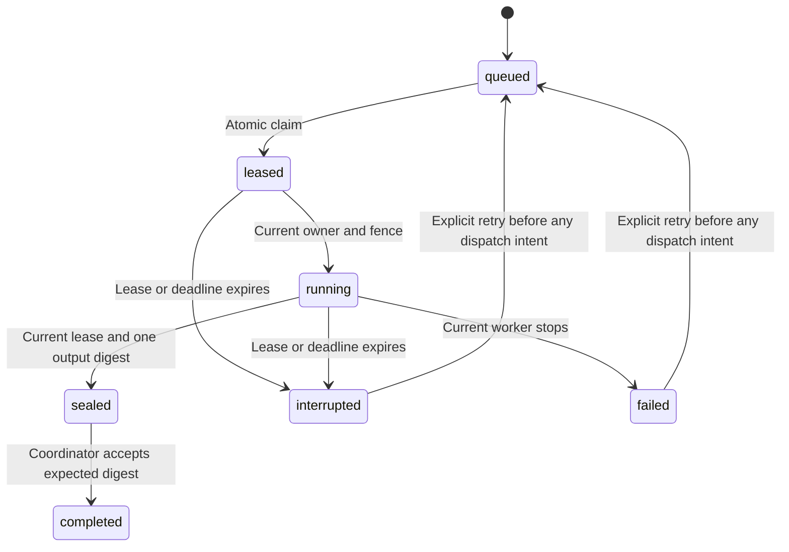

# Fenced task-state foundation

Status: unreleased internal prototype. It is tested as a local state store. Configured actor execution does not use it yet. It starts no workers, agents, or subagents.

## Stored contract

`src/tasks.ts` stores task specifications, attempts, ownership leases, dispatch intents, sealed-output references, terminal states, and transition events in owner-only `.redteam/tasks.sqlite`.

A specification pins its run, role, supplied question key, manifest hash, maximum attempts, and deadline. Creation cannot replace a prior task or reuse the same question key within a run. This detects duplicate keys, rather than semantic similarity between questions. Raw prompts, credentials, research text, and output content are outside this store.

## Ownership and transitions

Each claim increments the attempt and ownership fence. A stale worker cannot start, extend, fail, or seal a newer attempt. The stored expiry is authoritative; changing a client lease timestamp cannot extend it. Heartbeats cannot revive an expired lease or extend beyond the task deadline.

Sealing removes worker ownership and records one artifact reference and SHA-256 digest. Later workers cannot replace it. `complete` checks the coordinator's expected digest against the sealed record. This is a metadata guard: the coordinator must independently resolve and verify the artifact bytes before calling it. It does not verify a claim or establish report truth.

Cancellation invalidates active ownership and preserves existing output metadata. Expiry recovery marks unfinished tasks interrupted. It preserves attempts, fences, and dispatch intents, and never requeues automatically.

## Retry and budget boundary

The coordinator records an invocation identity before possible dispatch. Once any dispatch intent exists, the task cannot use `retryBeforeDispatch`, even when the previous attempt failed. An intent may represent a call whose execution is uncertain. A lease timeout must not cause another payment or side effect through automatic replay.

Task cancellation and recovery do not release budget reservations. The separate budget ledger remains authoritative for held inference liability and reported usage. There is no transaction spanning both stores, no integrated dispatcher, and no automatic cancellation signal propagation yet.

## Required integration before worker use

1. Freeze the configured run manifest and create one bounded actor task. Keep the actor deadline separate from a bounded coordinator finalization allowance.
2. Claim the task, hold its fence in the coordinator, and renew a live lease within its deadline. Workers must not receive database handles.
3. Before each adapter dispatch, check ownership, record the same invocation identity in the task and budget stores, and acquire the budget reservation. A partial failure must retain its conservative record.
4. On cancellation, ownership loss, or expiry, stop new requests and propagate an abort signal. Do not retry uncertain dispatches.
5. Persist the worker result as an artifact, verify its bytes, and accept it only under the current task fence. Preserve factual partial reports when acceptance fails.
6. Test expiry during inference, stale output after takeover, cancellation, restart, duplicate invocation identity, and budget retention with fake transport.

Global worker counts, hierarchy depth, child permissions, parent budgets, phase visibility, independent verification, and the commercial gate remain prerequisites for specialist orchestration. Passing these state-store tests does not enable the roundtable.

The prototype assumes a trusted local coordinator and clock. SQLite lock waits can delay local operations. Production isolation and distributed-clock behavior remain open.
