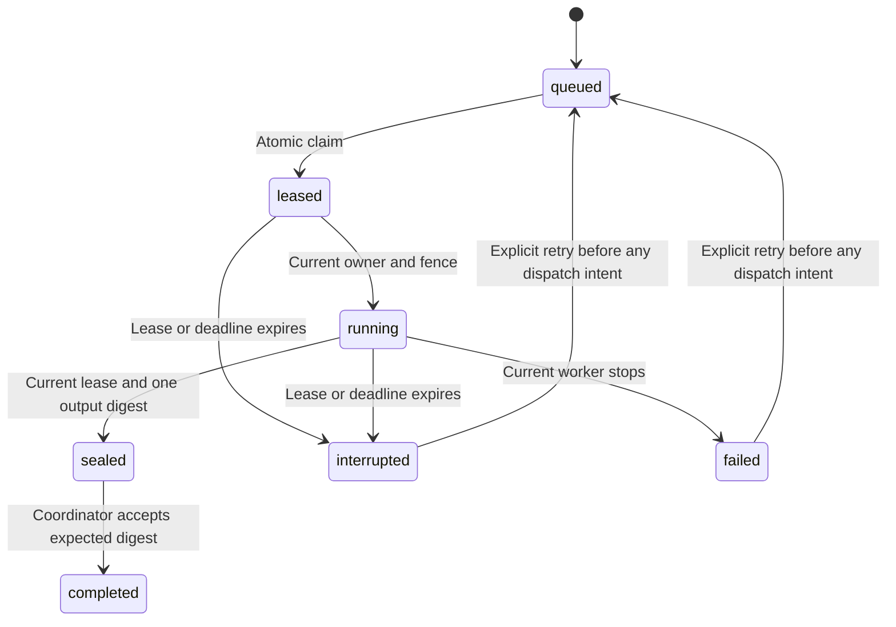

# Fenced task-state foundation

Status: integrated with one configured terminal actor. It does not launch specialist agents or subagents. Provider checks use fake transport; no live provider run is recorded.

## Stored contract

`src/tasks.ts` stores task specifications, attempts, ownership leases, dispatch intents, sealed-output references, terminal states, and transition events in owner-only `.redteam/tasks.sqlite`.

A specification pins its run, role, supplied question key, manifest hash, maximum attempts, and deadline. Creation cannot replace a prior task or reuse the same question key within a run. This detects duplicate keys, rather than semantic similarity between questions. Raw prompts, credentials, research text, and output content are outside this store.

## Ownership and transitions



Each claim increments the attempt and ownership fence. A stale worker cannot start, extend, fail, or seal a newer attempt. The stored expiry is authoritative; changing a client lease timestamp cannot extend it. Heartbeats cannot revive an expired lease or extend beyond the task deadline.

Sealing removes worker ownership and records one artifact reference and SHA-256 digest. Later workers cannot replace it. `complete` checks the coordinator's expected digest against the sealed record. This is a metadata guard: the coordinator must independently resolve and verify the artifact bytes before calling it. It does not verify a claim or establish report truth.

Cancellation invalidates active ownership and preserves existing output metadata. Expiry recovery marks unfinished tasks interrupted. An unpublished sealed result is interrupted when its coordinator deadline expires, while its output digest remains unchanged. Recovery preserves attempts, fences, and dispatch intents, and never requeues automatically.

## Retry and budget boundary

The coordinator records an invocation identity before possible dispatch. Once any dispatch intent exists, the task cannot use `retryBeforeDispatch`, even when the previous attempt failed. An intent may represent a call whose execution is uncertain. A lease timeout must not cause another payment or side effect through automatic replay.

Task cancellation and recovery do not release budget reservations. The separate budget ledger remains authoritative for held inference liability and reported usage. Before dispatch, the coordinator checks ownership and records the same invocation identity in both stores. An invalidated reservation is released only when it still proves dispatch never started. There is no transaction spanning both stores; partial failures retain conservative records.

## Configured actor integration

`src/actor-task.ts` manages ownership for `executeConfiguredActor`. The coordinator saves the manifest before inference. Its hash pins the scenario, model version/hash, limits, public configuration, and task policy. The task allows one attempt. A separate finalization allowance is at most ten seconds; it does not increase the inference deadline or budget.

The default lease is 30 seconds with a one-second heartbeat. The task deadline clamps extensions. Before dispatch, the coordinator records intent, reserves budget, and checks ownership again. Ownership loss aborts the actor and blocks new requests. SIGINT, SIGTERM, and an optional caller signal take the same bounded cancellation path.

The coordinator saves the raw worker result, verifies its artifact bytes, rechecks research permission and the pinned model, and seals/accepts under the current fence. A completed worker result can still be rejected. In that case, the main report contains no accepted decision; the raw candidate remains a labeled diagnostic artifact.

Configured reports contain four artifacts: manifest, worker result, budget snapshot, and task snapshot. The task snapshot includes transitions and dispatch identities. These are software execution records, not psychological validation.

## Inspection and recovery

```sh
redteam tasks list [RUN_ID]
redteam tasks show TASK_ID
redteam tasks cancel TASK_ID
redteam tasks recover RUN_ID
redteam actors diagnose RUN_ID
```

Cancellation is observed by the running coordinator's heartbeat and abort signal. A provider may still charge for an already dispatched request. Its unresolved liability remains held.

Use the separate actor diagnostic before considering repair of an unreadable final report. It checks saved publication syntax, identity, and recorded artifact hashes without opening the stores or executing recovery. Its result does not assess current task/budget state or authorize a decision. See [report diagnostics](report-diagnostics.md).

New configured runs recover expired configured tasks without retrying them. Explicit recovery uses the same path. It closes affected budget runs and marks in-flight usage uncertain. When a terminal configured task has no published report, recovery verifies its frozen manifest and any sealed bytes, then publishes a factual partial report with no accepted actor decision. Unsealed candidate files are excluded. Research withdrawal still restricts recovered report access.

Recovery is idempotent, repairs a missing catalog entry for its own partial report, rejects changed/symlink evidence, and leaves healthy active tasks alone. If recovery publishes while a cancelled coordinator is still finishing, that verified report is preserved; the coordinator returns without replacing it or duplicating its catalog entry. Recovery makes no provider request.

Version 0.7.1 also restores a catalog entry when a normal JSON report was saved before the process stopped. The saved task record and transition history must match the durable store, including the completed fence. Each listed artifact must resolve to bounded, regular JSON bytes with a unique identity and path. The manifest hash, task snapshot, and budget snapshot must match their evidence. For an accepted report, its actor result must equal the exact sealed worker bytes, and the pinned model must remain permitted in the recorded scope. The report's existing simulated action is restored without another decision or provider call. Rejected reports retain their rejection and no accepted action.

Catalog repair changes no report, artifact, task, or budget. A missing Markdown presentation does not prevent repair of a valid JSON publication. The budget snapshot remains report-time evidence; a later receipt can change the current ledger without invalidating that earlier snapshot. Concurrent repair produces one catalog entry.

Recovery returns `unavailable` with `research_restricted` when current research permission blocks normal publication recovery. Invalid or incomplete evidence returns `missing_or_invalid_records`. Files remain available to the local operator for diagnosis. These checks assume the local coordinator and stores are trusted. Artifact hashes do not authenticate records against an operator who controls all files and databases.

## Completed task with missing publication

Version 0.7.3 handles completion before JSON publication. During the task's frozen finalization window, recovery returns `unavailable` with `publication_pending` and changes no task or budget. This gives a healthy coordinator time to save its report. Once that deadline passes, recovery can publish a factual partial report if the manifest, model pin, scenario, and sealed bytes remain valid and current research permission allows it.

The report keeps the task `completed` and the exact sealed artifact identity/hash. It has `limited_coverage`, an empty actor-result list, recovery reason `publication_missing`, and decision acceptance `{ status: "unavailable", reason: "publication_missing" }`. This distinguishes a missing original publication from a rejected decision or an incomplete worker. Its catalog entry names the publication gap and includes no simulated action. The raw seal remains a labeled diagnostic artifact.

An open budget run closes without releasing unresolved liability. Existing closed runs retain their closure reason and recorded receipts. Task attempts, transitions, fences, and invocation identities do not change, and no provider request is made. Research permission is checked before recovery and again around publication/catalog insertion. Withdrawal also restricts retrieval and later catalog repair.

Recovered report retrieval independently reads the manifest pinned by the durable task and checks its bytes and model hash. It does not rely only on catalog model references. This protects older catalog entries whose references are empty. If a finishing coordinator must insert the catalog after recovery stopped, it retains the published recovery timestamp and frozen model references, including when the denied worker has no model in its own result.

The first valid JSON publication wins. A delayed coordinator preserves a recovery report rather than replacing it with its buffered decision. If the original report wins first, recovery verifies and preserves that publication. Only the JSON winner writes the Markdown presentation. A missing original publication is never inferred from staging bytes, and recovery never promotes a sealed worker result into a published accepted decision.

Global worker counts, hierarchy depth, child permissions, parent budgets, phase visibility, independent verification, and the commercial gate remain prerequisites for specialist orchestration. Passing these state-store tests does not enable the roundtable.

The prototype assumes a trusted local coordinator and clock. SQLite lock waits can delay local operations. Production isolation and distributed-clock behavior remain open.

JSON publication uses a flushed private staging file and an exclusive final link. Process interruption cannot expose a partially written final JSON record through that path. Publication still does not establish behavioral truth. See the [evidence publication contract](evidence-publication.md) for filesystem requirements and error boundaries.
